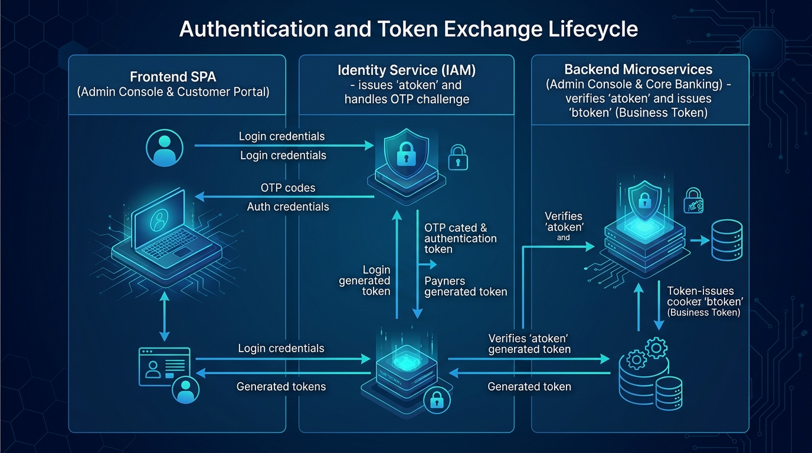
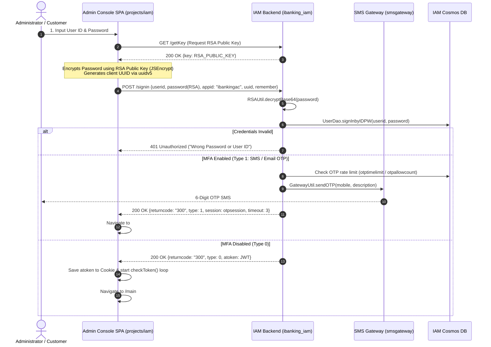
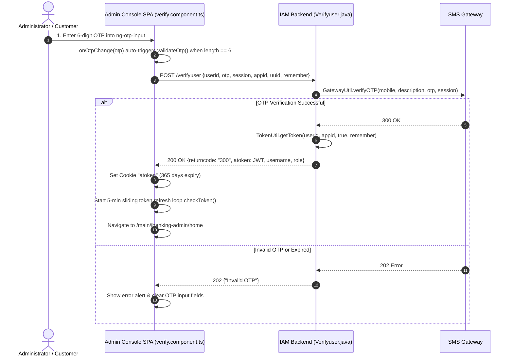
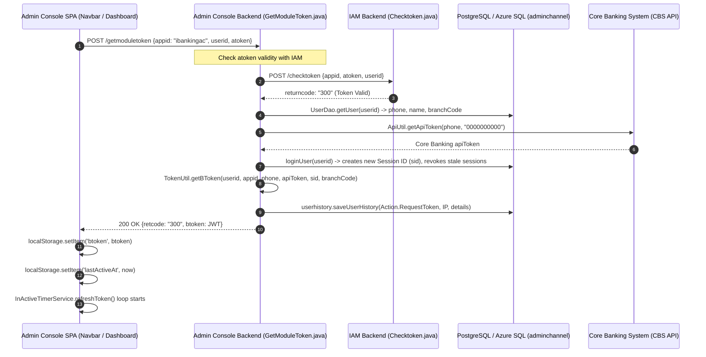
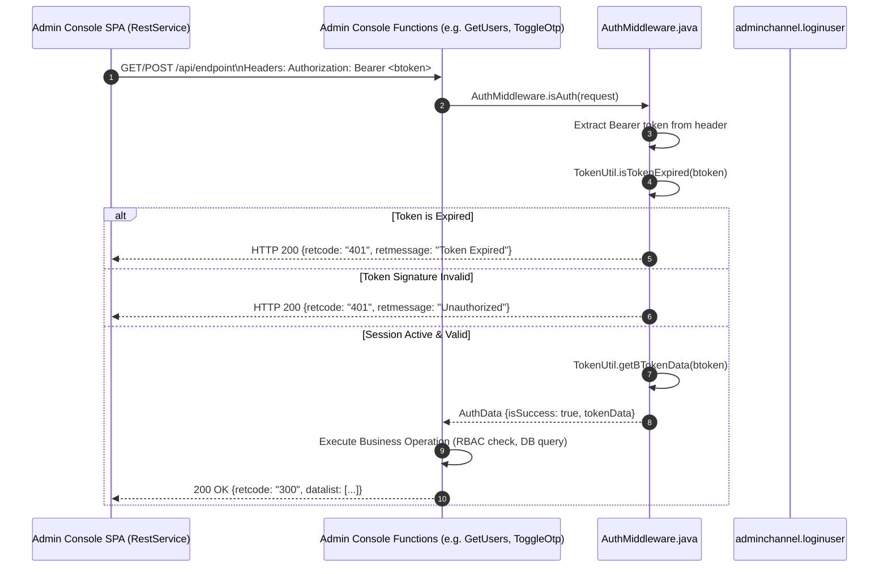
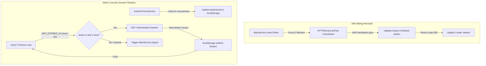
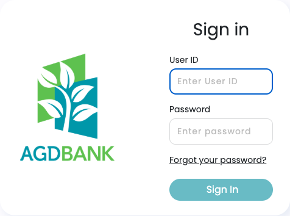
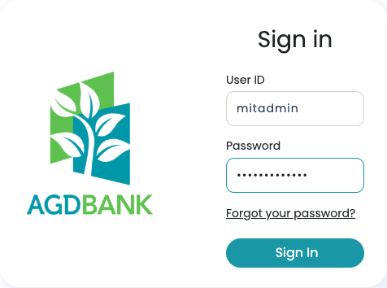
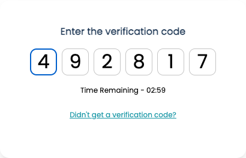

# Pillar 2: Customer & Admin Authentication Blueprint
> **MFS Digital Banking Internship 2026** | Software Development Department (SDD)  
> **Topic:** Customer & Admin Authentication, OTP Verification, JWT Access Tokens, and Refresh Tokens  
> **Target Repositories:** [`adminConsole_repo`](file:///Users/HlwanKyaw/Dev%20320/digital_banking/adminConsole_repo), [`iAM_repo`](file:///Users/HlwanKyaw/Dev%20320/digital_banking/iAM_repo), [`iBanking_repo`](file:///Users/HlwanKyaw/Dev%20320/digital_banking/iBanking_repo)

---

## 1. Executive Architecture Overview

In digital banking systems, security boundaries separate **Identity Management** (validating who the user is) from **Core Banking Operations** (initiating funds transfers, checking account limits, and performing administrative interventions). 

To achieve high security and maintain separation of concerns, the system adopts a **Dual-Token Microservice Architecture**:

```
+---------------------------------------------------------------------------------------------------+
|                                          CLIENT TIER                                              |
|            +------------------------------------+   +-------------------------------------+       |
|            |     iBanking Portal (Customer)     |   |   Admin Console SPA (Back-Office)   |       |
|            |  Angular 17+ (Retail / Corporate)  |   |  Angular 11+ Workspace              |       |
|            |  - projects/iam (Login & OTP)      |   |  - projects/iam (Login & OTP)       |       |
|            |  - projects/ibanking (Customer UI) |   |  - projects/ibanking-admin (Admin)  |       |
|            +------------------+-----------------+   +------------------+------------------+       |
+-------------------------------|----------------------------------------|--------------------------+
                                |                                        |
      (1) Signin / OTP Challenge|atoken        (1) Signin / OTP Challenge|atoken
                                v                                        v
+---------------------------------------------------------------------------------------------------+
|                            IDENTITY & ACCESS MANAGEMENT (IAM) SERVICE                             |
|  - Repository: iAM_repo/ibanking_iam (Azure Functions Java 17 + Cosmos DB)                        |
|  - Endpoints: /getKey (RSA), /signin (Credential Validation), /verifyuser (OTP Verification)      |
|  - Token Issuance: atoken (Authentication JWT, 365-day Cookie wrapper, 5-min sliding renewal)     |
|  - Multi-Factor: GatewayUtil.sendOTP() via YDNB SMS Gateway                                       |
+---------------------------------------------------------------------------------------------------+
                                |                                        |
                (2) Exchange atoken for btoken           (2) Exchange atoken for btoken
                                v                                        v
+------------------------------------+   +----------------------------------------------------------+
|     ibanking17 (Customer Backend)  |   |            admin_console (Back-Office Backend)           |
|  - Azure Functions (Java 17)       |   |  - Azure Functions (Java 17)                             |
|  - /getmoduletoken                 |   |  - /getmoduletoken (GetModuleTokenLogic.java)            |
|  - Validates atoken with IAM       |   |  - Validates atoken with IAM via /checktoken             |
|  - Exchanges Core Banking apiToken |   |  - Requests Core Banking apiToken (cid: 0000000000)      |
|  - Issues Customer btoken          |   |  - Issues Admin btoken (8h 20m validity, sid tracking)   |
+------------------------------------+   +----------------------------------------------------------+
                                |                                        |
                                +-------------------+--------------------+
                                                    |
                                                    v (3) Authenticated Business Requests (Bearer btoken)
+---------------------------------------------------------------------------------------------------+
|                                    PERSISTENCE & CORE SYSTEMS                                     |
|  - PostgreSQL cleandb (Schema: adminchannel) -> admin_user, roles, permissions                    |
|  - Session Storage -> loginuser (sid tracking, concurrent session invalidation)                   |
|  - Audit Log -> userhistory (tracks Action.RequestToken, Actor, IP, Delta)                        |
|  - Core Banking System (CBS) -> Account Balance, Statements, Operational Limits                   |
+---------------------------------------------------------------------------------------------------+
```

---

## 2. The Dual-Token Architecture (`atoken` vs `btoken`)

A foundational pattern interns must understand is the distinct division of responsibility between the two tokens:

| Dimension | `atoken` (Authentication Token) | `btoken` (Banking / Business Session Token) |
| :--- | :--- | :--- |
| **Issuing Authority** | **IAM** ([`ibanking_iam`](file:///Users/HlwanKyaw/Dev%20320/digital_banking/iAM_repo/ibanking_iam)) | **Admin Console Backend** ([`admin_console`](file:///Users/HlwanKyaw/Dev%20320/digital_banking/adminConsole_repo/admin_console)) |
| **Client Storage** | Browser Cookie (`cookieService.set('atoken')`) | Local Storage (`localStorage.setItem('btoken')`) |
| **Token Lifespan** | • Default: 1 Hour<br>• Remember Me: 30 Days<br>• Cookie Wrapper: 365 Days<br>• Sliding Refresh: 5-minute loop via `checkToken()` | • Default: 8 Hours 20 Minutes (Configurable in `local.settings.json`) |
| **Primary Scope** | **Identity Proof**:<br>Validates that the user has successfully cleared password and multi-factor OTP verification. Cannot directly invoke banking operations. | **Operational Authorization**:<br>Encapsulates the Core Banking `apiToken`, Session ID (`sid`), Branch Code, and User Role. Required for all business APIs. |
| **Payload Claims** | `sub` (User ID), `iss`, `iat`, `exp` | `sub` (User ID), `phone`, `apiToken` (CBS), `sid` (Session ID), `branchCode` |



---

## 3. Step-by-Step Lifecycle & Workflow

### Flow 1: Primary Authentication & Credential Exchange



#### Codebase References:
* **Frontend Login Component**: [`projects/iam/src/app/login/login.component.ts:L64-L114`](file:///Users/HlwanKyaw/Dev%20320/digital_banking/adminConsole_repo/admin_console_spa/projects/iam/src/app/login/login.component.ts#L64-L114)
  * `loginUser()`: Requests the RSA key and encrypts the password.
  * `goSignIn()`: Submits the payload to `/signin`. If `type == 1`, routes to `#/iam/verify`.
* **Backend Signin Function**: [`iAM_repo/ibanking_iam/src/main/java/com/function/Signin.java:L262-L308`](file:///Users/HlwanKyaw/Dev%20320/digital_banking/iAM_repo/ibanking_iam/src/main/java/com/function/Signin.java#L262-L308)
  * `goSignin()`: Decrypts password using RSA Private Key, validates identity against Cosmos DB.
  * `validateUser()`: Triggers OTP dispatch via the SMS Gateway.

---

### Flow 2: OTP Verification & `atoken` Generation



#### Codebase References:
* **Frontend Verify Component**: [`projects/iam/src/app/verify/verify.component.ts:L125-L165`](file:///Users/HlwanKyaw/Dev%20320/digital_banking/adminConsole_repo/admin_console_spa/projects/iam/src/app/verify/verify.component.ts#L125-L165)
  * `onOtpChange()`: Listens for digit input; when 6 digits are entered, immediately executes `validateOtp()`.
  * `resendOTP()`: Clears the countdown timer and requests a new OTP code.
* **Backend Verify Function**: [`iAM_repo/ibanking_iam/src/main/java/com/function/Verifyuser.java:L67-L122`](file:///Users/HlwanKyaw/Dev%20320/digital_banking/iAM_repo/ibanking_iam/src/main/java/com/function/Verifyuser.java#L67-L122)
  * `GatewayUtil.verifyOTP()`: Validates OTP against the SMS gateway session and issues a signed JJWT (`HS256`).

---

### Flow 3: Token Exchange - `atoken` to `btoken` (`getmoduletoken`)



#### Codebase References:
* **Frontend Exchange Point**: [`admin_console_spa/src/app/navbar/navbar.component.ts:L153-L180`](file:///Users/HlwanKyaw/Dev%20320/digital_banking/adminConsole_repo/admin_console_spa/src/app/navbar/navbar.component.ts#L153-L180)
  * `getModuleToken()`: Dispatches the `atoken` to the Admin Console backend to receive `btoken`.
* **Backend Token Exchange Handler**: [`admin_console/src/main/java/com/logic/GetModuleTokenLogic.java:L83-L145`](file:///Users/HlwanKyaw/Dev%20320/digital_banking/adminConsole_repo/admin_console/src/main/java/com/logic/GetModuleTokenLogic.java#L83-L145)
  * Obtains the core banking `apiToken`, creates an active session ID (`sid`) in the database, generates `btoken`, and records an immutable audit entry in `userhistory`.

---

### Flow 4: Business API Requests & Bearer Interceptor



#### Codebase References:
* **Frontend HTTP Interceptor / RestService**: [`projects/ibanking-admin/src/app/services/rest.service.ts:L40-L48`](file:///Users/HlwanKyaw/Dev%20320/digital_banking/adminConsole_repo/admin_console_spa/projects/ibanking-admin/src/app/services/rest.service.ts#L40-L48)
  * `getHeaders()`: Injects `'Authorization': 'Bearer ' + localStorage.getItem('btoken')` into every outgoing request.
* **Backend Auth Middleware**: [`admin_console/src/main/java/com/middlewares/AuthMiddleware.java:L16-L51`](file:///Users/HlwanKyaw/Dev%20320/digital_banking/adminConsole_repo/admin_console/src/main/java/com/middlewares/AuthMiddleware.java#L16-L51)
  * Validates token format, signature, expiration, and extracts claims.

---

### Flow 5: Silent Token Refresh & Sliding Session Renewal

To prevent active users from experiencing sudden session dropouts while avoiding indefinite session validity, background refresh loops are implemented:



#### Codebase References:
* **`atoken` Renewal**: [`admin_console_spa/src/app/main.service.ts:L85-L100`](file:///Users/HlwanKyaw/Dev%20320/digital_banking/adminConsole_repo/admin_console_spa/src/app/main.service.ts#L85-L100)
* **`btoken` Renewal**: [`projects/ibanking-admin/src/app/services/inactivetimer.service.ts:L24-L44`](file:///Users/HlwanKyaw/Dev%20320/digital_banking/adminConsole_repo/admin_console_spa/projects/ibanking-admin/src/app/services/inactivetimer.service.ts#L24-L44)

---

## 4. UI/UX Behavior & Visual Reference (Actual Running Admin Console)

These screenshots are captured directly from the running `admin_console_spa` instance (`projects/iam`).

### 1. Actual Sign-In Screen (`#/iam/login`)


* **Key Elements**:
  * **Brand Identity**: Authentic AGD Bank brand logo loaded dynamically via `assets/config.json`.
  * **User ID**: Clean text input with autofocus.
  * **Password Input**: Password field encrypted client-side using RSA public key before transmission.
  * **Forgot Password Link**: Routes directly to `#/iam/forgotpassword`.
  * **Sign In Action**: Styled primary button with interactive states (`.btn-primary`).

### 2. Actual Sign-In with Credentials Input


* **Form Validation**:
  * The **Sign In** button automatically activates when required fields are filled.
  * Passwords are typed as secure masked bullets, then transformed into base64 RSA encrypted text upon submission.

### 3. Actual OTP Verification Screen (`#/iam/verify`)


* **Key Elements**:
  * **Segmented OTP Input**: 6 separate digit boxes (`ng-otp-input`) with auto-advance and numeric-only filtering.
  * **Countdown Timer (`rtime`)**: Synchronized countdown timer initialized from `OTPTimeout` (e.g., `Time Remaining - 02:59`).
  * **Resend Action**: "Didn't get a verification code?" action link. Triggers `resendOTP()` and resets the timer loop.
  * **Auto-Submission**: When the 6th digit is typed, the component automatically invokes `validateOtp()` without requiring a manual click.

---

## 5. Security & Engineering Analysis for Interns

1. **Client-Side Credential Protection**:
   * Passwords are never sent across the network in plaintext. The frontend dynamically fetches the RSA public key (`getKey`) and encrypts credentials before dispatch.
2. **Brute Force & Rate Limiting**:
   * IAM inspects `OTPLogDao.otpcount()`. If the number of attempts within a configured time window exceeds policy, the account is temporarily blocked.
3. **Session Invalidation on Logout**:
   * On explicit logout, `main.service.ts:logout()` invalidates the token in IAM (`/detoken`), notifies the Admin backend (`/logout`), sets session status to `4` (Revoked), and purges local storage and cookies.

---

## 6. Daily Hands-on Checklist for Interns (Pillar 2)

- [ ] **Step 1: Code Trace**  
  Follow the authentication request lifecycle through [`login.component.ts`](file:///Users/HlwanKyaw/Dev%20320/digital_banking/adminConsole_repo/admin_console_spa/projects/iam/src/app/login/login.component.ts) and [`Signin.java`](file:///Users/HlwanKyaw/Dev%20320/digital_banking/iAM_repo/ibanking_iam/src/main/java/com/function/Signin.java).
- [ ] **Step 2: Token Inspection**  
  Open Chrome/Edge DevTools (F12) > Application Tab to inspect the cookies (`atoken`) and LocalStorage (`btoken`).
- [ ] **Step 3: OTP Lifecycle**  
  Examine [`Verifyuser.java`](file:///Users/HlwanKyaw/Dev%20320/digital_banking/iAM_repo/ibanking_iam/src/main/java/com/function/Verifyuser.java) to understand how the SMS gateway verifies OTPs and creates signed JWT claims.
- [ ] **Step 4: Silent Refresh**  
  Review [`InActiveTimerService.ts`](file:///Users/HlwanKyaw/Dev%20320/digital_banking/adminConsole_repo/admin_console_spa/projects/ibanking-admin/src/app/services/inactivetimer.service.ts) to see how mouse movement maintains the active banking session.
