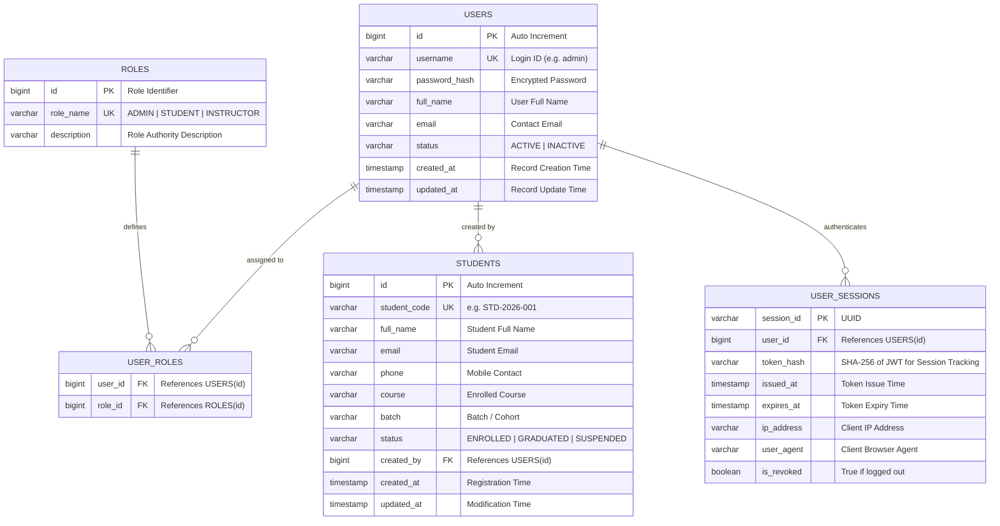
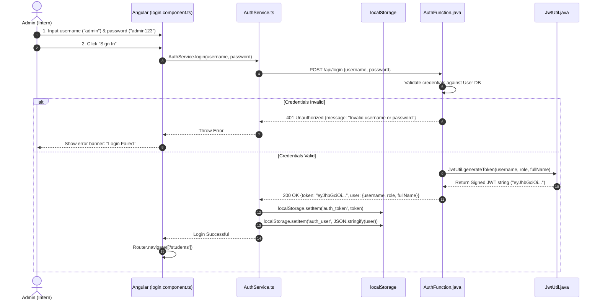
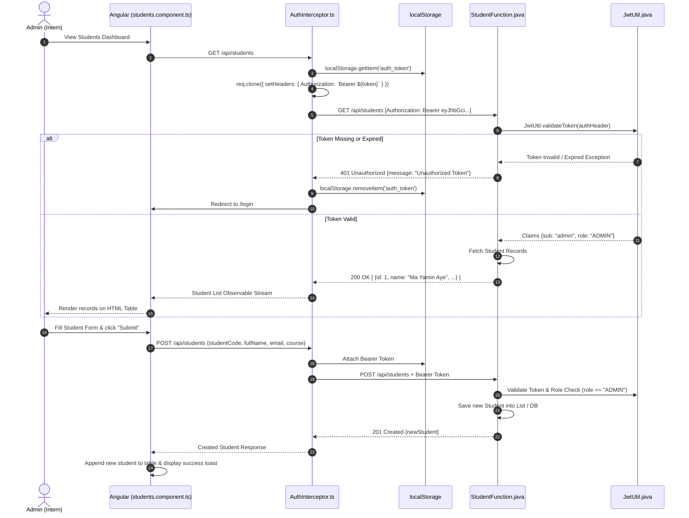

# Student Authentication & CRUD Demo Blueprint
> **MFS Digital Banking Internship 2026** | Software Development Department (SDD)  
> **Topic:** Practical Hands-on Architecture: JWT Authentication Lifecycle, LocalStorage Management, Angular HTTP Interceptor, and Protected Azure Functions (Java) CRUD APIs  
> **Target Cohort:** Ma Yamin Aye (`y.a@mit.com.mm`) & Mg Phyo Min Htet (`pmh@mit.com.mm`)  
> **Mentor / Lead:** Ko Hlwan Kyaw Phyo  
> **Sprint Period:** Week 2 (October 2026)  
> **Demo Project Path:** [`demo-projects/MFS_Intern`](file:///d:/hta/MIT/iBanking/demo-projects/MFS_Intern)  
> **GitHub Repository:** [`https://github.com/h-t-a/MFS_Intern.git`](https://github.com/h-t-a/MFS_Intern.git)  

---

## 1. Executive Summary & Educational Mission

### Objective
Intern engineers have foundational knowledge in traditional **HTML, CSS, and Vanilla JavaScript**, but our day-to-day enterprise operations in the **Software Development Department (SDD)** rely on **Angular (Frontend Single Page Application)** and **Azure Functions App (Java Serverless Microservices)**.

The primary mission of this milestone blueprint and demo sandbox is to demystify **Authentication & Authorization** in a modern enterprise architecture:
1. Understanding how credentials are submitted and validated when an authorized user enters the system.
2. Observing how the backend server generates and signs a cryptographically secure **JSON Web Token (JWT)** containing user identity and role claims.
3. Learning how the client browser stores the token securely in `window.localStorage`.
4. Understanding how subsequent protected CRUD requests (e.g., **Create Student** and **List Students in a Data Table**) automatically attach this token via an **Angular HTTP Interceptor** using the `Authorization: Bearer <token>` header.
5. Observing how Azure Functions validate token signatures and enforce Role-Based Access Control (RBAC) before returning sensitive data.

---

## 2. Transition Guide: From Vanilla HTML/CSS/JS to Angular + Azure Functions (Java)

To help interns bridge the conceptual gap between academic web development and production-grade banking systems, the following matrix compares traditional web patterns with modern enterprise standards:

| Dimension | Vanilla Web (Previous Intern Knowledge) | Modern Enterprise Stack (Angular + Azure Functions Java) |
| :--- | :--- | :--- |
| **Application Architecture** | **Multi-Page HTML:** Separate pages (`login.html`, `students.html`) requiring full browser page reloads on navigation. | **Single Page Application (SPA):** Seamless view transitions via Angular Router without full page reloads. |
| **API Communication** | `fetch('/api/login')` or raw `XMLHttpRequest` with manual promise chaining. | **`HttpClient` with RxJS Observables:** Type-safe, reactive data streams with declarative error handling and pipes. |
| **UI & Data Synchronization** | **Manual DOM Manipulation:** `document.getElementById('name').value` and string interpolation `innerHTML += '<tr>...'`. | **Declarative Data Binding:** Two-way binding `[(ngModel)]`, Reactive Forms, and structural directives (`@for` / `*ngFor`). |
| **Token Handling** | **Repetitive Manual Injection:** Writing `headers: { 'Authorization': 'Bearer ' + token }` manually on every single `fetch()` call across all scripts. | **Angular HTTP Interceptor:** Centralized interceptor pipeline that automatically clones outgoing requests and injects the Bearer token application-wide. |
| **Route Protection** | **Script-level Redirects:** Ad-hoc checks such as `if (!token) window.location.href = 'login.html'` embedded within each page script. | **Angular Route Guards (`CanActivateFn`):** Declarative route protection that stops unauthenticated navigation before components even initialize. |
| **Backend Architecture** | **Monolithic Web Server:** A monolithic Tomcat/Express server running continuously to handle all endpoints. | **Azure Functions (Serverless Microservices):** Isolated, independently scalable HTTP Triggers (`@FunctionName`, `@HttpTrigger`) executed on demand. |

---

## 3. Database Entity Relationship Diagram (ERD) & Schema

The following schema models an administrative student management system, adhering to standard enterprise auditing and session tracking principles:

### 3.1 Visual Mermaid ERD



### 3.2 SQL Table Definition (DDL)

```sql
-- 1. Roles Table
CREATE TABLE roles (
    id SERIAL PRIMARY KEY,
    role_name VARCHAR(50) UNIQUE NOT NULL,
    description VARCHAR(255)
);

-- 2. Users Table (System Admins & Staff)
CREATE TABLE users (
    id SERIAL PRIMARY KEY,
    username VARCHAR(50) UNIQUE NOT NULL,
    password_hash VARCHAR(255) NOT NULL,
    full_name VARCHAR(100) NOT NULL,
    email VARCHAR(100) UNIQUE NOT NULL,
    status VARCHAR(20) DEFAULT 'ACTIVE',
    created_at TIMESTAMP DEFAULT CURRENT_TIMESTAMP,
    updated_at TIMESTAMP DEFAULT CURRENT_TIMESTAMP
);

-- 3. User Roles Mapping Table
CREATE TABLE user_roles (
    user_id INT REFERENCES users(id) ON DELETE CASCADE,
    role_id INT REFERENCES roles(id) ON DELETE CASCADE,
    PRIMARY KEY (user_id, role_id)
);

-- 4. Students Table (Business Domain Data)
CREATE TABLE students (
    id SERIAL PRIMARY KEY,
    student_code VARCHAR(30) UNIQUE NOT NULL,
    full_name VARCHAR(100) NOT NULL,
    email VARCHAR(100) UNIQUE NOT NULL,
    phone VARCHAR(30) NOT NULL,
    course VARCHAR(100) NOT NULL,
    batch VARCHAR(50) NOT NULL,
    status VARCHAR(20) DEFAULT 'ENROLLED',
    created_by INT REFERENCES users(id),
    created_at TIMESTAMP DEFAULT CURRENT_TIMESTAMP,
    updated_at TIMESTAMP DEFAULT CURRENT_TIMESTAMP
);

-- 5. User Sessions Table (Session Audit & Token Tracking)
CREATE TABLE user_sessions (
    session_id VARCHAR(64) PRIMARY KEY,
    user_id INT REFERENCES users(id) ON DELETE CASCADE,
    token_hash VARCHAR(64) NOT NULL,
    issued_at TIMESTAMP DEFAULT CURRENT_TIMESTAMP,
    expires_at TIMESTAMP NOT NULL,
    ip_address VARCHAR(45),
    user_agent VARCHAR(255),
    is_revoked BOOLEAN DEFAULT FALSE
);

-- Initial Seed Data for Testing
INSERT INTO roles (id, role_name, description) VALUES 
(1, 'ADMIN', 'System Administrator with full student management rights'),
(2, 'STUDENT', 'Enrolled student with view-only rights');

INSERT INTO users (id, username, password_hash, full_name, email, status) VALUES 
(1, 'admin', 'admin123', 'Ko Hlwan Kyaw Phyo (Admin)', 'admin@mit.com.mm', 'ACTIVE');

INSERT INTO user_roles (user_id, role_id) VALUES (1, 1);

INSERT INTO students (student_code, full_name, email, phone, course, batch, status, created_by) VALUES
('STD-2026-001', 'Ma Yamin Aye', 'y.a@mit.com.mm', '09111111111', 'Digital Banking Core', 'Batch 2026', 'ENROLLED', 1),
('STD-2026-002', 'Mg Phyo Min Htet', 'pmh@mit.com.mm', '09222222222', 'Digital Banking Core', 'Batch 2026', 'ENROLLED', 1);
```

---

## 4. End-to-End Client-Server Architecture & JWT Lifecycle

### 4.1 System Topology Diagram

```
+--------------------------------------------------------------------------------------------------------+
|                                              BROWSER CLIENT                                            |
|                                                                                                        |
|   +------------------------------------+               +-------------------------------------------+   |
|   |         Login Page Component       |               |          Students Page Component          |   |
|   |   - Form: Username & Password      |               |   - Form: Add New Student                 |   |
|   |   - Calls: AuthService.login()     |               |   - Table: Render Student List            |   |
|   +-----------------+------------------+               +---------------------+---------------------+   |
|                     |                                                        |                         |
|                     | (1) POST /api/login                                    | (3) GET / POST Students |
|                     v                                                        v                         |
|   +------------------------------------------------------------------------------------------------+   |
|   |                                     ANGULAR HTTP INTERCEPTOR                                   |   |
|   |   - Checks if 'auth_token' exists in localStorage                                              |   |
|   |   - Clones request and appends: Authorization: Bearer <JWT_TOKEN>                              |   |
|   +--------------------------------------------------------------------------+---------------------+   |
|                                                                              |                         |
|                                             Browser Storage                  |                         |
|                                  +---------------------------------------+   |                         |
|                                  |        window.localStorage            |   |                         |
|                                  |  - 'auth_token': eyJhbGciOi...        |<--+                         |
|                                  |  - 'auth_user':  {"username":"admin"} |                             |
|                                  +---------------------------------------+                             |
+------------------------------------------------------------------------------|-------------------------+
                                                                               |
                                                       HTTPS / REST (JSON)     |
                                                                               v
+--------------------------------------------------------------------------------------------------------+
|                                    AZURE FUNCTIONS (JAVA 11 BACKEND)                                   |
|                                                                                                        |
|   +------------------------------------------+       +---------------------------------------------+   |
|   |             AuthFunction.java            |       |            StudentFunction.java             |   |
|   |  - @FunctionName("login")                |       |  - @FunctionName("getStudents")             |   |
|   |  - Validate Credentials                  |       |  - @FunctionName("createStudent")           |   |
|   |  - Generate Signed JWT via JwtUtil       |       |  - Extract Header "Authorization"           |   |
|   +---------------------+--------------------+       |  - Validate Signature & Claims via JwtUtil  |   |
|                         |                            +----------------------+----------------------+   |
|                         |                                                   |                          |
|                         v                                                   v                          |
|   +------------------------------------------------------------------------------------------------+   |
|   |                                   JWT UTILITY & SECURITY CORE                                  |   |
|   |   - JJWT (io.jsonwebtoken)                                                                     |   |
|   |   - Secret Key: "DigitalBankingSecretKey2026SecureMFSInternshipKey!"                           |   |
|   |   - Algorithm: HS256 (HMAC-SHA256)                                                             |   |
|   |   - Claims: Subject (User ID), Role, Full Name, Expiration (2 Hours)                            |   |
|   +------------------------------------------------------------------------------------------------+   |
|                                                  |                                                     |
|                                                  v                                                     |
|   +------------------------------------------------------------------------------------------------+   |
|   |                                    IN-MEMORY / PERSISTENT STORE                                |   |
|   |   - Users Map: 'admin' -> password: 'admin123', role: 'ADMIN'                                  |   |
|   |   - Students List: Ma Yamin Aye, Mg Phyo Min Htet, ...                                         |   |
|   +------------------------------------------------------------------------------------------------+   |
+--------------------------------------------------------------------------------------------------------+
```

---

### 4.2 Sequence Flow 1: Login & Token Storage Lifecycle



---

### 4.3 Sequence Flow 2: Protected CRUD (List & Add Student) with Interceptor



---

## 5. Step-by-Step Codebase Integration Walkthrough

### 5.1 Backend: Azure Functions (Java 11)

#### 1. `JwtUtil.java` (Token Generation & Validation)
The core utility responsible for creating, signing, and parsing three-part (`Header.Payload.Signature`) JSON Web Tokens:

```java
package com.demo.util;

import io.jsonwebtoken.Claims;
import io.jsonwebtoken.Jwts;
import io.jsonwebtoken.SignatureAlgorithm;
import java.util.Date;
import java.util.HashMap;
import java.util.Map;

public class JwtUtil {
    // In production, this secret is retrieved from Azure Key Vault or environment settings
    private static final String SECRET_KEY = "DigitalBankingSecretKey2026SecureMFSInternshipKey!";
    private static final long EXPIRATION_TIME = 2 * 60 * 60 * 1000; // 2 Hours (Milliseconds)

    // Token Generation (Signing with HS256)
    public static String generateToken(String username, String role, String fullName) {
        Map<String, Object> claims = new HashMap<>();
        claims.put("role", role);
        claims.put("fullName", fullName);

        return Jwts.builder()
                .setClaims(claims)
                .setSubject(username)
                .setIssuedAt(new Date(System.currentTimeMillis()))
                .setExpiration(new Date(System.currentTimeMillis() + EXPIRATION_TIME))
                .signWith(SignatureAlgorithm.HS256, SECRET_KEY.getBytes())
                .compact();
    }

    // Token Verification & Claims Parsing
    public static Claims validateTokenAndGetClaims(String authHeader) throws Exception {
        if (authHeader == null || !authHeader.startsWith("Bearer ")) {
            throw new IllegalArgumentException("Missing or invalid Authorization header");
        }
        String token = authHeader.substring(7); // Strip "Bearer " prefix (7 characters)
        return Jwts.parser()
                .setSigningKey(SECRET_KEY.getBytes())
                .parseClaimsJws(token)
                .getBody();
    }
}
```

#### 2. `AuthFunction.java` (Login Endpoint)
Validates user credentials anonymously and issues the signed JWT:

```java
package com.demo;

import com.demo.model.LoginRequest;
import com.demo.model.LoginResponse;
import com.demo.service.AuthService;
import com.google.gson.Gson;
import com.microsoft.azure.functions.*;
import com.microsoft.azure.functions.annotation.*;
import java.util.Optional;

public class AuthFunction {
    private final AuthService authService = new AuthService();
    private final Gson gson = new Gson();

    @FunctionName("login")
    public HttpResponseMessage login(
            @HttpTrigger(name = "req", methods = {HttpMethod.POST}, 
                         authLevel = AuthorizationLevel.ANONYMOUS, 
                         route = "login") HttpRequestMessage<Optional<String>> request,
            final ExecutionContext context) {

        context.getLogger().info("Processing login request...");
        String body = request.getBody().orElse("");
        LoginRequest loginReq = gson.fromJson(body, LoginRequest.class);

        LoginResponse response = authService.authenticate(loginReq.getUsername(), loginReq.getPassword());
        if (response == null) {
            return request.createResponseBuilder(HttpStatus.UNAUTHORIZED)
                    .header("Content-Type", "application/json")
                    .body("{\"message\": \"Invalid username or password\"}")
                    .build();
        }

        return request.createResponseBuilder(HttpStatus.OK)
                .header("Content-Type", "application/json")
                .body(gson.toJson(response))
                .build();
    }
}
```

#### 3. `StudentFunction.java` (Protected CRUD Endpoints)
Protected endpoints requiring a valid `Authorization: Bearer <token>` header:

```java
package com.demo;

import com.demo.model.Student;
import com.demo.service.StudentService;
import com.demo.util.JwtUtil;
import com.google.gson.Gson;
import com.microsoft.azure.functions.*;
import com.microsoft.azure.functions.annotation.*;
import io.jsonwebtoken.Claims;
import java.util.List;
import java.util.Optional;

public class StudentFunction {
    private final StudentService studentService = new StudentService();
    private final Gson gson = new Gson();

    // 1. GET /api/students (List Students)
    @FunctionName("getStudents")
    public HttpResponseMessage getStudents(
            @HttpTrigger(name = "req", methods = {HttpMethod.GET}, 
                         authLevel = AuthorizationLevel.ANONYMOUS, 
                         route = "students") HttpRequestMessage<Optional<String>> request,
            final ExecutionContext context) {

        // Step 1: Security Authorization Check
        String authHeader = request.getHeaders().get("authorization");
        try {
            Claims claims = JwtUtil.validateTokenAndGetClaims(authHeader);
            context.getLogger().info("Authorized request by user: " + claims.getSubject());
        } catch (Exception e) {
            return request.createResponseBuilder(HttpStatus.UNAUTHORIZED)
                    .header("Content-Type", "application/json")
                    .body("{\"message\": \"Unauthorized: " + e.getMessage() + "\"}")
                    .build();
        }

        // Step 2: Return Business Data
        List<Student> students = studentService.getAllStudents();
        return request.createResponseBuilder(HttpStatus.OK)
                .header("Content-Type", "application/json")
                .body(gson.toJson(students))
                .build();
    }

    // 2. POST /api/students (Add Student)
    @FunctionName("createStudent")
    public HttpResponseMessage createStudent(
            @HttpTrigger(name = "req", methods = {HttpMethod.POST}, 
                         authLevel = AuthorizationLevel.ANONYMOUS, 
                         route = "students") HttpRequestMessage<Optional<String>> request,
            final ExecutionContext context) {

        // Step 1: Security & RBAC Check (Only ADMIN allowed)
        String authHeader = request.getHeaders().get("authorization");
        Claims claims;
        try {
            claims = JwtUtil.validateTokenAndGetClaims(authHeader);
            String role = (String) claims.get("role");
            if (!"ADMIN".equalsIgnoreCase(role)) {
                return request.createResponseBuilder(HttpStatus.FORBIDDEN)
                        .header("Content-Type", "application/json")
                        .body("{\"message\": \"Forbidden: Only ADMIN can register students\"}")
                        .build();
            }
        } catch (Exception e) {
            return request.createResponseBuilder(HttpStatus.UNAUTHORIZED)
                    .header("Content-Type", "application/json")
                    .body("{\"message\": \"Unauthorized: " + e.getMessage() + "\"}")
                    .build();
        }

        // Step 2: Create Student Logic
        String body = request.getBody().orElse("");
        Student newStudent = gson.fromJson(body, Student.class);
        Student created = studentService.addStudent(newStudent, claims.getSubject());

        return request.createResponseBuilder(HttpStatus.CREATED)
                .header("Content-Type", "application/json")
                .body(gson.toJson(created))
                .build();
    }
}
```

---

### 5.2 Frontend: Angular SPA

#### 1. `auth.interceptor.ts` (The Central Bridge)
Unlike Vanilla JS where developers must manually construct the `Authorization` header on every `fetch()` call, the Angular HTTP Interceptor intercepts all outgoing HTTP requests across the entire application:

```typescript
import { HttpInterceptorFn, HttpErrorResponse } from '@angular/common/http';
import { inject } from '@angular/core';
import { Router } from '@angular/router';
import { catchError, throwError } from 'rxjs';

export const authInterceptor: HttpInterceptorFn = (req, next) => {
  const router = inject(Router);
  const token = localStorage.getItem('auth_token');

  // Clone request and inject Authorization Header if token exists
  let authReq = req;
  if (token) {
    authReq = req.clone({
      setHeaders: {
        Authorization: `Bearer ${token}`
      }
    });
  }

  // Intercept 401 Unauthorized responses and auto-redirect to login
  return next(authReq).pipe(
    catchError((error: HttpErrorResponse) => {
      if (error.status === 401) {
        localStorage.removeItem('auth_token');
        localStorage.removeItem('auth_user');
        router.navigate(['/login']);
      }
      return throwError(() => error);
    })
  );
};
```

#### 2. `auth.guard.ts` (Route Protection)
Prevents unauthenticated users from accessing protected URLs (e.g., navigating directly to `/students` without logging in):

```typescript
import { CanActivateFn, Router } from '@angular/router';
import { inject } from '@angular/core';

export const authGuard: CanActivateFn = (route, state) => {
  const router = inject(Router);
  const token = localStorage.getItem('auth_token');

  if (token) {
    return true; // Token exists -> allow route activation
  }

  // No token -> redirect to login view
  router.navigate(['/login']);
  return false;
};
```

#### 3. `auth.service.ts` (Login & LocalStorage State Management)
```typescript
import { Injectable, inject, signal } from '@angular/core';
import { HttpClient } from '@angular/common/http';
import { Router } from '@angular/router';
import { tap } from 'rxjs/operators';
import { Observable } from 'rxjs';

export interface User {
  username: string;
  role: string;
  fullName: string;
}

export interface LoginResponse {
  token: string;
  user: User;
}

@Injectable({
  providedIn: 'root'
})
export class AuthService {
  private http = inject(HttpClient);
  private router = inject(Router);
  private apiUrl = 'http://localhost:7071/api';

  currentUser = signal<User | null>(this.getStoredUser());

  login(credentials: { username: string; password: string }): Observable<LoginResponse> {
    return this.http.post<LoginResponse>(`${this.apiUrl}/login`, credentials).pipe(
      tap(res => {
        localStorage.setItem('auth_token', res.token);
        localStorage.setItem('auth_user', JSON.stringify(res.user));
        this.currentUser.set(res.user);
      })
    );
  }

  logout(): void {
    localStorage.removeItem('auth_token');
    localStorage.removeItem('auth_user');
    this.currentUser.set(null);
    this.router.navigate(['/login']);
  }

  getToken(): string | null {
    return localStorage.getItem('auth_token');
  }

  isLoggedIn(): boolean {
    return !!this.getToken();
  }

  private getStoredUser(): User | null {
    const userStr = localStorage.getItem('auth_user');
    return userStr ? JSON.parse(userStr) : null;
  }
}
```

---

## 6. Interns Hands-on Action Checklist (Ma Yamin Aye & Mg Phyo Min Htet)

Intern engineers must complete the following 5 hands-on checkpoints to cement their understanding:

- [ ] **Task 1: Inspect Login Network Payload (F12 DevTools)**  
  In Chrome or Edge, open Developer Tools (`F12`), switch to the **Network** tab, and filter by **Fetch/XHR**. Log in using `admin` / `admin123`. Observe the raw HTTP POST request to `/api/login` and verify the signed JWT token string in the JSON response.
- [ ] **Task 2: Examine `localStorage` & Decode the JWT**  
  In DevTools, switch to **Application** > **Storage** > **Local Storage** (`http://localhost:4200`). Inspect the `auth_token` key. Copy the token string, navigate to [jwt.io](https://jwt.io), and inspect the decoded claims (`sub`, `role: "ADMIN"`, and `exp` timestamp).
- [ ] **Task 3: Verify HTTP Interceptor Header Injection**  
  When viewing the Students Dashboard, select the `/api/students` request in the Network tab. Expand **Request Headers** and verify that `Authorization: Bearer eyJhbGci...` is attached automatically without being hardcoded in `student.service.ts`.
- [ ] **Task 4: Test the 401 Unauthorized Security Barrier**  
  In the Application tab, delete the `auth_token` entry from Local Storage. Then click **"Refresh List"** or attempt to create a new student. Observe how the Azure Functions backend rejects the call with `401 Unauthorized`, and how the Angular `authInterceptor` catches the error and redirects the view to `/login`.
- [ ] **Task 5: Hands-on Code Challenge (Mini Feature Extension)**  
  Extend the `Student` entity by introducing an additional property (e.g., `phone` or `nrc`):
  1. Add the field to the backend Java model (`Student.java`).
  2. Add the field to the frontend TypeScript model (`student.model.ts`).
  3. Update the form template and table columns in `students.component.html`.

---

## 7. Trellis Compliance & Verification Sign-Off

- **Trellis Standard:** `ai-dev-playbook` v0.1 (`trellis/GEMINI.md`, `trellis/templates/walkthrough.md`)
- **DoD Verification:**
  - [x] Implementation Plan artifact created and reviewed.
  - [x] Full ERD and relational DDL provided.
  - [x] Token lifecycle, sequence diagrams, and client-server workflows documented.
  - [x] Runnable sample project created on local disk.
  - [x] English documentation aligned with previous Astro milestone standards.
