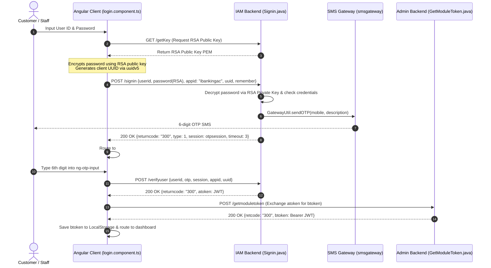
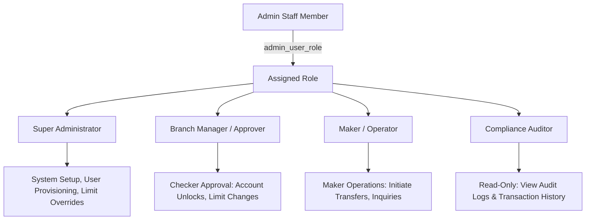
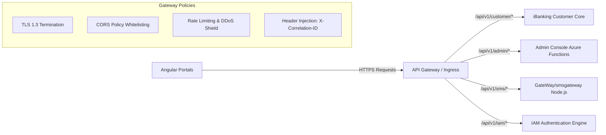
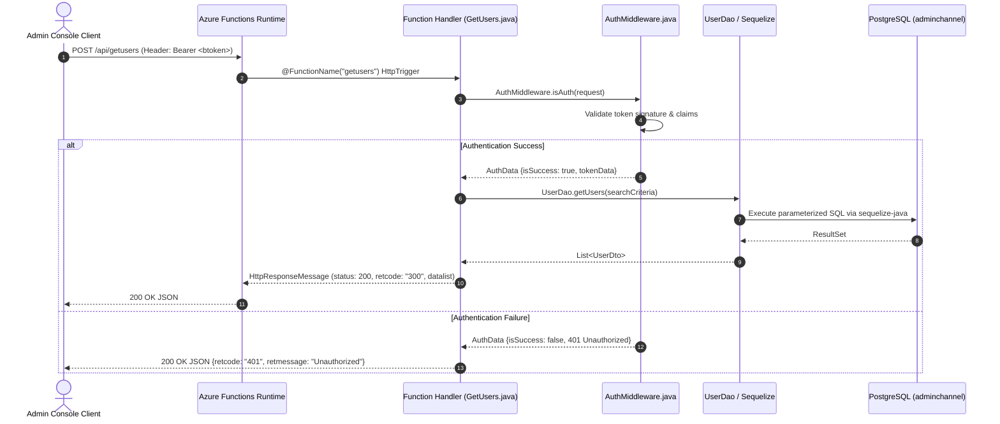
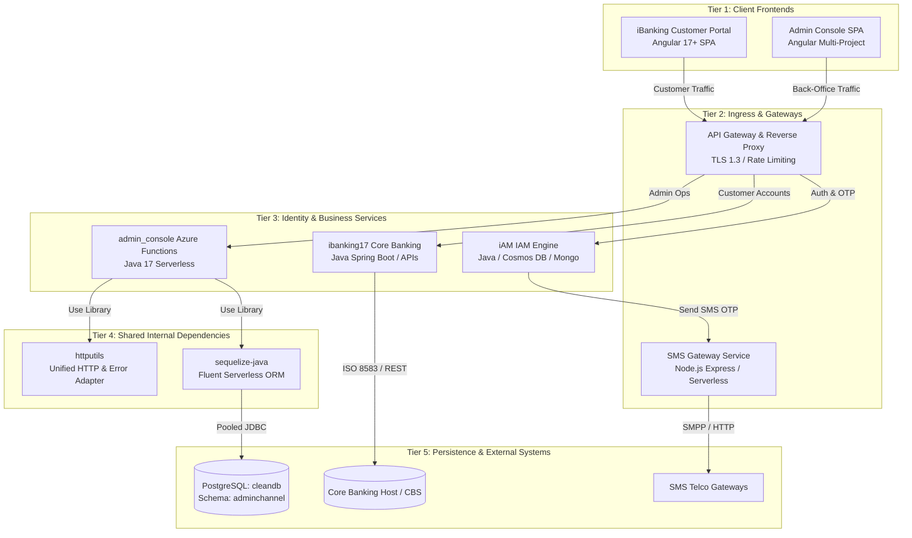

# Week 2 Sprint: Master Technical Blueprint & Actionable Checklists

> **Program:** MFS 3-Months Learning Journey (Digital Banking 2026)  
> **Target Department:** SDD (Software Development Department)  
> **Intern Cohort:** Ma Yamin Aye (`y.a@mit.com.mm`) & Mg Phyo Min Htet (`pmh@mit.com.mm`)  
> **Mentor / Lead:** Ko Hlwan Kyaw Phyo  
> **Sprint Period:** Week 2 (October 12, 2026 – October 16, 2026)  
> **Core Objective:** Comprehensive technical mastery of the MFS Dual-Portal Architecture, IAM integration, serverless microservices, and shared internal dependencies.

---

## Architecture Blueprint Overview

```
+---------------------------------------------------------------------------------------------------+
|                                          CLIENT TIER                                              |
|   +-------------------------------------+             +---------------------------------------+   |
|   |     iBanking Portal (Customer)      |             |    Admin Console SPA (Back-Office)    |   |
|   |  Angular 17+ SPA (Retail & SME)     |             |  Angular SPA (Multi-Project: iam+ops) |   |
|   |  PII Masking, Self-Service, OTP MFA |             |  Strict RBAC, Maker-Checker, Auditing |   |
|   +------------------+------------------+             +-------------------+-------------------+   |
+----------------------|----------------------------------------------------|-----------------------+
                       | HTTPS / REST                                       | HTTPS / REST
                       v                                                    v
+---------------------------------------------------------------------------------------------------+
|                                   API GATEWAY & INGRESS TIER                                      |
|   - Reverse Proxy & Routing: /api/v1/customer/* vs. /api/v1/admin/*                               |
|   - Security Controls: TLS Termination, CORS Filter (HttpUtils), Global IP Rate Limiting          |
|   - Header Propagation: X-Correlation-ID, X-User-ID, X-Tenant-ID, X-Forwarded-For                 |
|   - Gateway Services: GateWay/smsgateway (OTP SMS & Notification Routing)                         |
+-------------------------------------------------+-------------------------------------------------+
                                                  |
                                                  v
+---------------------------------------------------------------------------------------------------+
|                               SERVERLESS MICROSERVICES TIER                                       |
|   +-------------------------------------+             +---------------------------------------+   |
|   |   admin_console (Azure Functions)   |             |   ibanking_iam (Identity & Access)    |   |
|   |   Java 17, @HttpTrigger Endpoints   |             |   RSA Encryption Key (/getKey)        |   |
|   |   Maker-Checker, Core Config, Ops   |             |   Credential Check & OTP Dispatch     |   |
|   +------------------+------------------+             +-------------------+-------------------+   |
|                      |                                                    |                       |
|                      +--------------------------+-------------------------+                       |
|                                                 |                                                 |
|                                                 v                                                 |
|                   +-----------------------------------------------------------+                   |
|                   |               SHARED INTERNAL DEPENDENCIES                |                   |
|                   |   - httputils: Unified HTTP Request/Response Mappers      |                   |
|                   |   - sequelize-java: Fluent SQL Query Engine & ORM         |                   |
|                   +-----------------------------+-----------------------------+                   |
+-------------------------------------------------|-------------------------------------------------+
                                                  | Pooled JDBC / Direct Query Execution
                                                  v
+---------------------------------------------------------------------------------------------------+
|                                  PERSISTENCE & AUDIT TIER                                         |
|   - PostgreSQL (Database: cleandb, Schema: adminchannel)                                          |
|   - RBAC & Security: admin_user, admin_user_role, roles, permissions, blacklisttoken              |
|   - Core Banking Ops: accountmapping, branchsetting, atmsequence, cheque, cifmapping              |
|   - Immutable Audit: userhistory (Actor, Action, Delta, IP, Timestamp)                            |
+---------------------------------------------------------------------------------------------------+
```

---

## Table of Contents

1. [Pillar 1: Portal Architecture (iBanking Portal vs. Admin Console SPA)](#pillar-1-portal-architecture-ibanking_portal-vs-adminconsole)
2. [Pillar 2: Customer Authentication (OTP Verification & Token Lifecycle)](#pillar-2-customer-authentication-otp-verification-jwt-access-tokens--refresh-tokens)
3. [Pillar 3: Admin Authentication (RBAC, Roles, Permissions & Session Management)](#pillar-3-admin-authentication-rbac-roles-permissions-and-session-management)
4. [Pillar 4: API Gateway (API Routing, Auth Policies & Request Ingress)](#pillar-4-api-gateway-api-routing-authentication-policies-and-request-handling)
5. [Pillar 5: Serverless Microservices (Azure Functions Java Architecture)](#pillar-5-serverless-services-azure-functions-java-execution)
6. [Pillar 6: Security & Testing (Authorization, Error Handling, Logging & Audit Trails)](#pillar-6-security--testing-authorization-error-handling-logging-and-audit-trails)
7. [Pillar 7: Documentation (Architecture Synthesis & Reporting)](#pillar-7-documentation-architecture-diagram-and-key-findings)
8. [Pillar 8: Internal Dependencies Deep Dive (httputils & sequelize-java)](#pillar-8-internal-dependencies-deep-dive-httputils-sequelize-java)

---

## Pillar 1: Portal Architecture (`iBanking_portal` vs. `adminconsole`)

### 1. Objective & Learning Scope
Understand the architectural, structural, UX, and operational differences between the customer-facing digital banking portal ([`iBanking_repo/ibanking-portal`](file:///Users/HlwanKyaw/Dev%20320/digital_banking/iBanking_repo/ibanking-portal)) and the administrative back-office console ([`adminConsole_repo/admin_console_spa`](file:///Users/HlwanKyaw/Dev%20320/digital_banking/adminConsole_repo/admin_console_spa)).

### 2. Architectural Comparison Matrix

| Architectural Dimension | Customer Portal (`iBanking_portal`) | Back-Office Console (`adminconsole`) |
| :--- | :--- | :--- |
| **Primary Audience** | Retail consumers, SME account holders | Bank branch staff, tellers, compliance auditors, superadmins |
| **Primary Repositories** | [`iBanking_repo/ibanking-portal`](file:///Users/HlwanKyaw/Dev%20320/digital_banking/iBanking_repo/ibanking-portal), [`iBanking_repo/ibanking17`](file:///Users/HlwanKyaw/Dev%20320/digital_banking/iBanking_repo/ibanking17) | [`adminConsole_repo/admin_console_spa`](file:///Users/HlwanKyaw/Dev%20320/digital_banking/adminConsole_repo/admin_console_spa), [`adminConsole_repo/admin_console`](file:///Users/HlwanKyaw/Dev%20320/digital_banking/adminConsole_repo/admin_console) |
| **Workspace Architecture** | Single Angular application structured around consumer banking modules | Multi-project Angular workspace (`projects/iam`, `projects/ibanking-admin`) |
| **Security Boundary** | Zero-trust public internet; strictly self-service operations | Intranet / VPN protected; Maker-Checker dual control |
| **Data Masking (PII)** | Enforced masking on all sensitive fields (e.g. `**** **** 1234`, masked CIF) | Operational data visibility with strict field-level permission gating |
| **Session Lifetime** | 5–15 minutes inactivity timeout; re-authentication on financial actions | Extended active operational session (up to 500 mins) with sliding mouse-activity renewal |
| **Route Protection** | Angular `AuthGuard` checking authenticated customer token | Compound guards: `AuthGuard` (identity) + `RoleGuard` (RBAC feature check) |

### 3. Structural Codebase Tracing
* **Admin Console Workspace Configuration**:
  - File: [`adminConsole_repo/admin_console_spa/angular.json:L8-L200`](file:///Users/HlwanKyaw/Dev%20320/digital_banking/adminConsole_repo/admin_console_spa/angular.json#L8-L200)
  - Notice the multi-project declaration: root `authentication` project, `projects/iam` (shared login & verification), and `projects/ibanking-admin` (back-office management suite).
* **Customer Portal Routing**:
  - File: [`iBanking_repo/ibanking-portal/src/app/app-routing.module.ts`](file:///Users/HlwanKyaw/Dev%20320/digital_banking/iBanking_repo/ibanking-portal/src/app/app-routing.module.ts)
  - Focuses on user-centric paths: `/accounts`, `/transfers`, `/bill-payment`, `/cards`.
* **Admin Console Module Routing & Guards**:
  - File: [`adminConsole_repo/admin_console_spa/projects/iam/src/app/app-routing.module.ts:L13-L23`](file:///Users/HlwanKyaw/Dev%20320/digital_banking/adminConsole_repo/admin_console_spa/projects/iam/src/app/app-routing.module.ts#L13-L23)
  - File: [`adminConsole_repo/admin_console_spa/src/app/auth.guard.ts:L1-L25`](file:///Users/HlwanKyaw/Dev%20320/digital_banking/adminConsole_repo/admin_console_spa/src/app/auth.guard.ts#L1-L25)

### 4. Hands-on Actionable Checklist (Pillar 1)

- [ ] **Step 1: Workspace Inspection**  
  Open [`adminConsole_repo/admin_console_spa/angular.json`](file:///Users/HlwanKyaw/Dev%20320/digital_banking/adminConsole_repo/admin_console_spa/angular.json) and locate the `projects` object. Identify the differences between the `authentication` build target and the `iam` build target.
- [ ] **Step 2: Component Hierarchy Trace**  
  Compare the navigation bars: inspect [`adminConsole_repo/admin_console_spa/src/app/navbar/navbar.component.html`](file:///Users/HlwanKyaw/Dev%20320/digital_banking/adminConsole_repo/admin_console_spa/src/app/navbar/navbar.component.html) versus the customer portal header in `iBanking_repo/ibanking-portal`. Document how administrative menus are dynamically generated from user roles.
- [ ] **Step 3: Route Guard Comparison**  
  Open [`admin_console_spa/src/app/auth.guard.ts`](file:///Users/HlwanKyaw/Dev%20320/digital_banking/adminConsole_repo/admin_console_spa/src/app/auth.guard.ts). Trace how the guard interrogates `mainService.atokenExist()` and redirects unauthenticated users to `#/iam/login`.
- [ ] **Step 4: PII Masking Verification**  
  Observe how account numbers are displayed in the customer portal (masked) versus the admin console user account lookup (`projects/ibanking-admin/src/app/account-mapping/account-mapping.component.html`).
- [ ] **Step 5: Summarize Findings**  
  Draft a 1-page comparison table highlighting audience, session length, and security requirements for inclusion in Weekly Report #2.

---

## Pillar 2: Customer Authentication (OTP Verification, JWT Access Tokens & Refresh Tokens)

### 1. Objective & Learning Scope
Dissect the complete multi-factor authentication (MFA) lifecycle, studying client-side RSA credential encryption, SMS OTP generation & challenge verification, dual-token generation (`atoken` vs. `btoken`), and sliding session token renewal.

### 2. Dual-Token Architecture Matrix

| Token Type | Issuer | Storage Target | Lifetime | Scope & Purpose |
| :--- | :--- | :--- | :--- | :--- |
| **`atoken`** (Authentication Token) | IAM Service (`ibanking_iam`) | Cookie (Domain scoped, 365-day persist) | 15 Minutes (Sliding) | Validates user identity and tenant profile across IAM applications. Cannot invoke core banking business functions directly. |
| **`btoken`** (Business Bearer Token) | Admin Backend (`GetModuleTokenLogic`) | LocalStorage (`localStorage.btoken`) | 500 Minutes | Carries administrative session ID (`sid`), core banking `apiToken`, branch code, and role scopes. Required in all operational API requests. |

### 3. Step-by-Step Codebase Tracing & Lifecycle Diagram



* **Frontend Handshake & Encryption**:
  - File: [`admin_console_spa/projects/iam/src/app/login/login.component.ts:L64-L114`](file:///Users/HlwanKyaw/Dev%20320/digital_banking/adminConsole_repo/admin_console_spa/projects/iam/src/app/login/login.component.ts#L64-L114)
* **Backend RSA Decryption & Signin**:
  - File: [`iAM_repo/ibanking_iam/src/main/java/com/function/Signin.java:L262-L308`](file:///Users/HlwanKyaw/Dev%20320/digital_banking/iAM_repo/ibanking_iam/src/main/java/com/function/Signin.java#L262-L308)
* **OTP Verification Handler**:
  - File: [`iAM_repo/ibanking_iam/src/main/java/com/function/Verifyuser.java:L67-L122`](file:///Users/HlwanKyaw/Dev%20320/digital_banking/iAM_repo/ibanking_iam/src/main/java/com/function/Verifyuser.java#L67-L122)
* **Token Exchange & Session Binding**:
  - File: [`admin_console/src/main/java/com/logic/GetModuleTokenLogic.java:L83-L145`](file:///Users/HlwanKyaw/Dev%20320/digital_banking/adminConsole_repo/admin_console/src/main/java/com/logic/GetModuleTokenLogic.java#L83-L145)

### 4. Hands-on Actionable Checklist (Pillar 2)

- [ ] **Step 1: RSA Handshake Inspection**  
  Open Chrome DevTools > Network tab. Trigger a login on `#/iam/login`. Inspect the response of `/getKey` and verify that the outgoing payload to `/signin` contains an encrypted `password` string instead of plaintext.
- [ ] **Step 2: OTP State & Countdown Verification**  
  Open [`projects/iam/src/app/verify/verify.component.ts`](file:///Users/HlwanKyaw/Dev%20320/digital_banking/adminConsole_repo/admin_console_spa/projects/iam/src/app/verify/verify.component.ts). Inspect `timer()` (lines 56–76) and confirm how `rtime` decrements from `02:59` to `00:00`.
- [ ] **Step 3: Auto-Submit Mechanism**  
  Inspect `onOtpChange(otp: string)` in `verify.component.ts:L78-L84`. Confirm that `otp.length == 6` automatically triggers `validateOtp()` without user click.
- [ ] **Step 4: Dual-Token Browser Inspection**  
  Open DevTools > Application tab. Locate `atoken` in the Cookies storage and verify its domain scope. Then inspect LocalStorage to confirm `btoken` is stored under `localStorage.btoken`.
- [ ] **Step 5: Sliding Refresh Loop**  
  Inspect [`admin_console_spa/src/app/main.service.ts:L85-L100`](file:///Users/HlwanKyaw/Dev%20320/digital_banking/adminConsole_repo/admin_console_spa/src/app/main.service.ts#L85-L100). Identify the RxJS `interval(5 * 60 * 1000)` pipe that calls `checktoken` to renew `atoken` every 5 minutes.

---

## Pillar 3: Admin Authentication (RBAC, Roles, Permissions and Session Management)

### 1. Objective & Learning Scope
Understand how internal staff identities are validated, governed by Role-Based Access Control (RBAC), mapped to granular permissions in PostgreSQL, and maintained or revoked through strict session controls.

### 2. Core RBAC Principles & Role Hierarchy



### 3. Database Schema Mapping (`cleandb.adminchannel`)
The PostgreSQL database dump ([`assets/adminconsole.dump`](file:///Users/HlwanKyaw/Dev%20320/digital_banking/Internship_2026/assets/adminconsole.dump)) establishes the core RBAC schema:
* `admin_user`: Staff account profile, status (`ACTIVE`, `LOCKED`, `SUSPENDED`), password hash, branch affiliation.
* `admin_user_role`: Many-to-many junction mapping staff IDs to assigned role IDs.
* `roles`: Role definitions (e.g. `SUPER_ADMIN`, `MAKER`, `CHECKER`, `AUDITOR`).
* `permissions`: Granular permission flags (e.g. `USER_LOCK`, `USER_UNLOCK`, `LIMIT_SETUP`, `ACCOUNT_MAP`).
* `blacklisttoken`: Stores revoked JWT signatures upon logout or administrative session termination.
* `session_history`: Records session start, client IP, user agent, and logout timestamp.

### 4. Step-by-Step Codebase Tracing
* **Admin Module Token Generation**:
  - File: [`admin_console/src/main/java/com/logic/GetModuleTokenLogic.java:L100-L140`](file:///Users/HlwanKyaw/Dev%20320/digital_banking/adminConsole_repo/admin_console/src/main/java/com/logic/GetModuleTokenLogic.java#L100-L140)
  - Checks user status, fetches branch settings, registers session ID (`sid`), and generates the signed `btoken`.
* **RBAC Enforcement Middleware**:
  - File: [`admin_console/src/main/java/com/middlewares/AuthMiddleware.java:L16-L51`](file:///Users/HlwanKyaw/Dev%20320/digital_banking/adminConsole_repo/admin_console/src/main/java/com/middlewares/AuthMiddleware.java#L16-L51)
  - Intercepts requests, strips `Bearer `, validates token signature, expiration, and ensures token is not blacklisted via `ServerUtil.isBTokenAuth(btoken)`.
* **Silent Inactivity Session Monitor**:
  - File: [`admin_console_spa/projects/ibanking-admin/src/app/services/inactivetimer.service.ts:L24-L44`](file:///Users/HlwanKyaw/Dev%20320/digital_banking/adminConsole_repo/admin_console_spa/projects/ibanking-admin/src/app/services/inactivetimer.service.ts#L24-L44)
  - Listens to global DOM events (`mousemove`, `keydown`). If user was active within 5 minutes, triggers `GET /refreshtoken?userid=` 10 seconds before `JWT_EXPIRES_IN`.

### 5. Hands-on Actionable Checklist (Pillar 3)

- [ ] **Step 1: Database RBAC Schema Verification**  
  Launch `psql` or PgAdmin4 connected to `cleandb`. Query the RBAC structure:
  ```sql
  SELECT u.userid, u.username, r.rolename, p.permissionname
  FROM adminchannel.admin_user u
  JOIN adminchannel.admin_user_role ur ON u.id = ur.user_id
  JOIN adminchannel.roles r ON ur.role_id = r.id
  JOIN adminchannel.role_permission rp ON r.id = rp.role_id
  JOIN adminchannel.permissions p ON rp.permission_id = p.id
  LIMIT 10;
  ```
- [ ] **Step 2: Token Validation Code Walkthrough**  
  Open [`AuthMiddleware.java:L24-L45`](file:///Users/HlwanKyaw/Dev%20320/digital_banking/adminConsole_repo/admin_console/src/main/java/com/middlewares/AuthMiddleware.java#L24-L45). Trace how a missing header returns `ServerStatus.UNAUTHORIZED` (`401`) and an expired token returns `ServerMessage.TOKEN_EXPIRED`.
- [ ] **Step 3: User Lock / Unlock Flow Inspection**  
  Open [`admin_console/src/main/java/com/function/LockUser.java`](file:///Users/HlwanKyaw/Dev%20320/digital_banking/adminConsole_repo/admin_console/src/main/java/com/function/LockUser.java) and [`UnlockUser.java`](file:///Users/HlwanKyaw/Dev%20320/digital_banking/adminConsole_repo/admin_console/src/main/java/com/function/UnlockUser.java). Observe how Maker actions require verification before updating user status in the database.
- [ ] **Step 4: Blacklist Token Examination**  
  Inspect [`admin_console/src/main/java/com/function/Logout.java:L40-L65`](file:///Users/HlwanKyaw/Dev%20320/digital_banking/adminConsole_repo/admin_console/src/main/java/com/function/Logout.java#L40-L65). Verify how explicit logout inserts the token's `jti` into `adminchannel.blacklisttoken`.
- [ ] **Step 5: Inactivity Timeout Testing**  
  Open [`inactivetimer.service.ts`](file:///Users/HlwanKyaw/Dev%20320/digital_banking/adminConsole_repo/admin_console_spa/projects/ibanking-admin/src/app/services/inactivetimer.service.ts). Set a breakpoint in DevTools at line 35. Leave the browser untouched for the timeout window and confirm redirection to logout.

---

## Pillar 4: API Gateway (API Routing, Authentication Policies and Request Handling)

### 1. Objective & Learning Scope
Master how traffic ingress is handled across digital banking microservices, examining URL rewriting, reverse proxying, CORS policy management, rate limiting, and header propagation.

### 2. Traffic Routing & Ingress Model



### 3. Step-by-Step Codebase Tracing
* **SMS Gateway Service Architecture**:
  - Directory: [`GateWay/smsgateway`](file:///Users/HlwanKyaw/Dev%20320/digital_banking/GateWay/smsgateway)
  - Routes: [`GateWay/smsgateway/routes/sms`](file:///Users/HlwanKyaw/Dev%20320/digital_banking/GateWay/smsgateway/routes/sms)
  - Controllers: [`GateWay/smsgateway/controllers`](file:///Users/HlwanKyaw/Dev%20320/digital_banking/GateWay/smsgateway/controllers)
* **CORS Header Specification**:
  - File: [`Dependencies Project/httputils/src/main/java/com/starless/http/HttpUtils.java:L7-L14`](file:///Users/HlwanKyaw/Dev%20320/digital_banking/Dependencies%20Project/httputils/src/main/java/com/starless/http/HttpUtils.java#L7-L14)
  - Injects `Access-Control-Allow-Origin`, `Access-Control-Allow-Methods`, and `Access-Control-Allow-Headers`.
* **Standardized Bearer Header Injection (Frontend RestService)**:
  - File: [`admin_console_spa/projects/ibanking-admin/src/app/services/rest.service.ts:L40-L48`](file:///Users/HlwanKyaw/Dev%20320/digital_banking/adminConsole_repo/admin_console_spa/projects/ibanking-admin/src/app/services/rest.service.ts#L40-L48)
  - Injects `Authorization: Bearer <btoken>` and content type headers into every outgoing HTTP request.
* **API Postman Collections**:
  - Directory: [`adminConsole_repo/admin_console/api_collections`](file:///Users/HlwanKyaw/Dev%20320/digital_banking/adminConsole_repo/admin_console/api_collections)

### 4. Hands-on Actionable Checklist (Pillar 4)

- [ ] **Step 1: Explore SMS Gateway Routes**  
  Open [`GateWay/smsgateway/package.json`](file:///Users/HlwanKyaw/Dev%20320/digital_banking/GateWay/smsgateway/package.json) and inspect dependencies. Review how SMS requests are routed through Express/Serverless adapters.
- [ ] **Step 2: CORS Header Trace**  
  Open [`HttpUtils.java:L7-L14`](file:///Users/HlwanKyaw/Dev%20320/digital_banking/Dependencies%20Project/httputils/src/main/java/com/starless/http/HttpUtils.java#L7-L14). Trace where `getCORSHeaders()` is invoked in response mappers.
- [ ] **Step 3: Bearer Interceptor Verification**  
  Open DevTools > Network. Click any operation in the Admin Console (e.g., User Setup). Select the outgoing XHR request and verify that the `Authorization: Bearer ...` header is attached.
- [ ] **Step 4: Postman Collection Test**  
  Import the JSON collection from [`adminConsole_repo/admin_console/api_collections`](file:///Users/HlwanKyaw/Dev%20320/digital_banking/adminConsole_repo/admin_console/api_collections) into Postman. Execute an unauthenticated call and verify that the Gateway/Function returns HTTP 401 Unauthorized.
- [ ] **Step 5: Header Propagation Analysis**  
  Document how `X-Correlation-ID` passes from the client request through the Gateway into the microservice execution context.

---

## Pillar 5: Serverless Services (Azure Functions Java Execution)

### 1. Objective & Learning Scope
Understand serverless backend architecture inside [`adminConsole_repo/admin_console`](file:///Users/HlwanKyaw/Dev%20320/digital_banking/adminConsole_repo/admin_console), studying HTTP triggers, execution contexts, stateless function handlers, and multi-tenant environment profiles.

### 2. Runtime Configuration & Lifecycle

* **Maven Dependency Definition**:
  - File: [`adminConsole_repo/admin_console/pom.xml:L1-L150`](file:///Users/HlwanKyaw/Dev%20320/digital_banking/adminConsole_repo/admin_console/pom.xml#L1-L150)
  - Targets Java 17, packages via `azure-functions-maven-plugin`, and imports `azure-functions-java-library` alongside internal dependencies (`httputils`, `sequelize-java`).
* **Runtime Settings (`host.json`)**:
  - File: [`adminConsole_repo/admin_console/host.json`](file:///Users/HlwanKyaw/Dev%20320/digital_banking/adminConsole_repo/admin_console/host.json)
  - Declares function execution timeout, telemetry sampling rates, and HTTP route prefix overrides (`"routePrefix": "api"`).
* **Local Development Profiles (`local.settings.json`)**:
  - File: [`adminConsole_repo/admin_console/local.settings.json`](file:///Users/HlwanKyaw/Dev%20320/digital_banking/adminConsole_repo/admin_console/local.settings.json)
  - Multi-tenant profiles: `ndb.json`, `tcb.json`, `ydnb.json`. Encapsulates JDBC connection strings, encryption secrets, and tenant identifiers.

### 3. Serverless Invocation Pattern



* **Function Endpoint Samples**:
  - [`admin_console/src/main/java/com/function/GetUsers.java:L1-L85`](file:///Users/HlwanKyaw/Dev%20320/digital_banking/adminConsole_repo/admin_console/src/main/java/com/function/GetUsers.java#L1-L85)
  - [`admin_console/src/main/java/com/function/GetModuleToken.java:L1-L45`](file:///Users/HlwanKyaw/Dev%20320/digital_banking/adminConsole_repo/admin_console/src/main/java/com/function/GetModuleToken.java#L1-L45)
  - [`admin_console/src/main/java/com/function/RefreshToken.java:L1-L70`](file:///Users/HlwanKyaw/Dev%20320/digital_banking/adminConsole_repo/admin_console/src/main/java/com/function/RefreshToken.java#L1-L70)

### 4. Hands-on Actionable Checklist (Pillar 5)

- [ ] **Step 1: Inspect `pom.xml` Serverless Plugins**  
  Open [`admin_console/pom.xml`](file:///Users/HlwanKyaw/Dev%20320/digital_banking/adminConsole_repo/admin_console/pom.xml). Locate the `azure-functions-maven-plugin` configuration. Identify `appName`, `resourceGroup`, and `runtime` version.
- [ ] **Step 2: Inspect `host.json` & `local.settings.json`**  
  Open [`host.json`](file:///Users/HlwanKyaw/Dev%20320/digital_banking/adminConsole_repo/admin_console/host.json). Confirm the extension bundle and route settings. Check `local.settings.json` for database connection properties.
- [ ] **Step 3: Analyze `@FunctionName` Annotations**  
  Open [`GetUsers.java`](file:///Users/HlwanKyaw/Dev%20320/digital_banking/adminConsole_repo/admin_console/src/main/java/com/function/GetUsers.java). Trace the method parameters: `@HttpTrigger`, `HttpRequestMessage`, and `ExecutionContext`.
- [ ] **Step 4: Cold-Start vs. Warm Execution Analysis**  
  Review how `admin_console` avoids heavyweight framework startup by utilizing lightweight dependencies (`sequelize-java`) instead of full Spring Boot container initialization.
- [ ] **Step 5: Local Function Startup (Dry-Run)**  
  Verify the build command in the `admin_console` directory:
  ```bash
  cd "adminConsole_repo/admin_console"
  mvn clean compile
  ```

---

## Pillar 6: Security & Testing (Authorization, Error Handling, Logging and Audit Trails)

### 1. Objective & Learning Scope
Review defense-in-depth security practices across the digital banking system, including authorization gates, standardized error envelopes, structured logging, and immutable database audit trails.

### 2. Standardized API Response Architecture
To prevent leaking stack traces or internal database errors to clients, all banking microservices wrap output in standard response envelopes:
```json
{
  "retcode": "300",
  "retmessage": "Success",
  "data": { ... },
  "datalist": [ ... ]
}
```
* **Server Status & Message Codes**:
  - File: [`admin_console/src/main/java/com/constants/ServerStatus.java`](file:///Users/HlwanKyaw/Dev%20320/digital_banking/adminConsole_repo/admin_console/src/main/java/com/constants/ServerStatus.java) (`300: Success`, `200: Validation/Warning`, `401: Unauthorized`, `500: System Error`)
  - File: [`admin_console/src/main/java/com/constants/ServerMessage.java`](file:///Users/HlwanKyaw/Dev%20320/digital_banking/adminConsole_repo/admin_console/src/main/java/com/constants/ServerMessage.java)

### 3. Centralized Audit Trail Engine (`userhistory`)
In compliance with central bank regulations, every state-changing administrative action must be recorded immutably:
* **Audit Table**: `adminchannel.userhistory`
  - Columns: `id`, `userid`, `action`, `description`, `oldvalue`, `newvalue`, `ipaddress`, `createddate`, `status`.
* **Audit Logic Implementation**:
  - File: [`admin_console/src/main/java/com/userhistory/UserHistoryDao.java`](file:///Users/HlwanKyaw/Dev%20320/digital_banking/adminConsole_repo/admin_console/src/main/java/com/userhistory)
  - Whenever an admin updates a role, unlocks an account, or modifies a limit, `UserHistoryDao.save()` records a before-and-after JSON delta with the operator's IP address.

### 4. Hands-on Actionable Checklist (Pillar 6)

- [ ] **Step 1: Error Response Envelope Inspection**  
  Open [`ServerMessage.java`](file:///Users/HlwanKyaw/Dev%20320/digital_banking/adminConsole_repo/admin_console/src/main/java/com/constants/ServerMessage.java). Note the standardized error strings (e.g., `UNAUTHORIZED`, `TOKEN_EXPIRED`, `INVALID_REQUEST`).
- [ ] **Step 2: Query Audit History Table**  
  Execute a query in PostgreSQL:
  ```sql
  SELECT id, userid, action, description, ipaddress, createddate 
  FROM adminchannel.userhistory 
  ORDER BY createddate DESC 
  LIMIT 5;
  ```
- [ ] **Step 3: Code Trace Audit Logging**  
  Open [`admin_console/src/main/java/com/logic/GetModuleTokenLogic.java:L142`](file:///Users/HlwanKyaw/Dev%20320/digital_banking/adminConsole_repo/admin_console/src/main/java/com/logic/GetModuleTokenLogic.java#L142). Locate the invocation of `UserHistoryDao.saveHistory()` that logs the token generation event.
- [ ] **Step 4: SQL Injection Mitigation Verification**  
  Review [`Dependencies Project/sequelize-java/src/main/java/com/starless/Sequelize.java`](file:///Users/HlwanKyaw/Dev%20320/digital_banking/Dependencies%20Project/sequelize-java/src/main/java/com/starless/Sequelize.java). Confirm that queries utilize `PreparedStatement` with parameterized placeholders (`?`) rather than raw string concatenation.
- [ ] **Step 5: Client-Side Notification & Logout Gate**  
  Open [`admin_console_spa/src/app/services/noti.service.ts:L40-L59`](file:///Users/HlwanKyaw/Dev%20320/digital_banking/adminConsole_repo/admin_console_spa/src/app/services/noti.service.ts#L40-L59). Trace how `showCatchNoti()` traps `err.status == 401` or `err.status == 0` and triggers immediate session termination via `main.logout()`.

---

## Pillar 7: Documentation (Architecture Diagram and Key Findings)

### 1. Objective & Learning Scope
Synthesize the architectural analysis into formal engineering artifacts, creating an end-to-end system diagram and compiling key findings for the Weekly Progress Report #2 submission.

### 2. Comprehensive System Architecture Diagram



### 3. Key Findings Summary for Interns
1. **Dual-Token Separation**: Digital banking requires splitting authentication from business authorization (`atoken` vs. `btoken`) to protect core banking services from public internet compromise.
2. **Serverless Footprint**: Azure Functions provide rapid horizontal scaling, but require lean libraries (`sequelize-java`) instead of heavy monolithic frameworks to eliminate cold-start latency.
3. **Defense in Depth**: Client-side RSA encryption ensures passwords are never visible on the wire; server-side audit logs ensure complete traceability of all operational actions.

### 4. Hands-on Actionable Checklist (Pillar 7)

- [ ] **Step 1: Architecture Review**  
  Review the Mermaid diagram above and verify each data flow against the codebases in the workspace.
- [ ] **Step 2: Diagram Validation**  
  Ensure that the client, gateway, serverless functions, shared libraries, and database tiers are accurately represented.
- [ ] **Step 3: Astro Documentation Check**  
  Navigate to the Internship Portal (`http://localhost:4321/architecture`). Verify that the high-level architecture diagram and descriptions render properly.
- [ ] **Step 4: Weekly Report Synthesis**  
  Open [`Internship_2026/src/pages/reports/week-1.astro`](file:///Users/HlwanKyaw/Dev%20320/digital_banking/Internship_2026/src/pages/reports/week-1.astro) as a style guide. Draft the technical findings section for Weekly Report #2.
- [ ] **Step 5: Code Defense Readiness**  
  Prepare a 5-minute verbal walkthrough explaining how a customer login differs from an admin login end-to-end.

---

## Pillar 8: Internal Dependencies Deep Dive (`httputils`, `sequelize-java`)

### 1. Objective & Learning Scope
Conduct a deep dive into the internal shared libraries housed in [`Dependencies Project`](file:///Users/HlwanKyaw/Dev%20320/digital_banking/Dependencies%20Project), understanding the design rationale, runtime execution, and performance benefits over commercial open-source alternatives in serverless architectures.

### 2. Dependency Deep-Dive & Comparative Matrix

| Library | Directory | Core Technology | Architectural Purpose | Why Built Internally |
| :--- | :--- | :--- | :--- | :--- |
| **`httputils`** | [`Dependencies Project/httputils`](file:///Users/HlwanKyaw/Dev%20320/digital_banking/Dependencies%20Project/httputils) | Java 1.8+, Jakarta RESTful Web Services, Jackson Databind, Azure Functions Java Library, Lombok | Standardized HTTP request/response wrapper and adapter | Unifies request mapping across Azure Functions (`HttpRequestMessage`) and standard Jakarta WS RS; enforces uniform CORS headers and error envelopes without boilerplate. |
| **`sequelize-java`** | [`Dependencies Project/sequelize-java`](file:///Users/HlwanKyaw/Dev%20320/digital_banking/Dependencies%20Project/sequelize-java) | Java 1.8+, JDBC, PostgreSQL Driver, MSSQL Driver, Lombok | Fluent SQL query builder and lightweight ORM | Heavyweight ORMs (Hibernate, Spring Data JPA) cause severe memory overhead (100MB+) and unacceptable cold-start delays in serverless functions. `sequelize-java` provides fluent SQL building with zero reflection overhead. |

### 3. Detailed Component Breakdown

#### A. `httputils` Architecture
* **`HttpUtils.java`**:
  - File: [`Dependencies Project/httputils/src/main/java/com/starless/http/HttpUtils.java:L6-L14`](file:///Users/HlwanKyaw/Dev%20320/digital_banking/Dependencies%20Project/httputils/src/main/java/com/starless/http/HttpUtils.java#L6-L14)
  - Provides `getCORSHeaders()` to ensure cross-origin compliance across all serverless endpoints.
* **`HttpRequest.java`**:
  - File: [`Dependencies Project/httputils/src/main/java/com/starless/http/HttpRequest.java:L16-L53`](file:///Users/HlwanKyaw/Dev%20320/digital_banking/Dependencies%20Project/httputils/src/main/java/com/starless/http/HttpRequest.java#L16-L53)
  - Generic model encapsulating `body`, `headers`, `queryParams`, `pathParams`, `url`, and HTTP `method`.
* **`RequestMapper.java`**:
  - File: [`Dependencies Project/httputils/src/main/java/com/starless/http/RequestMapper.java:L66-L97`](file:///Users/HlwanKyaw/Dev%20320/digital_banking/Dependencies%20Project/httputils/src/main/java/com/starless/http/RequestMapper.java#L66-L97)
  - Translates Azure Functions' `HttpRequestMessage<Optional<T>>` into a clean, typed `HttpRequest<T>`.

#### B. `sequelize-java` Architecture
* **`Sequelize.java`**:
  - File: [`Dependencies Project/sequelize-java/src/main/java/com/starless/Sequelize.java:L28-L60`](file:///Users/HlwanKyaw/Dev%20320/digital_banking/Dependencies%20Project/sequelize-java/src/main/java/com/starless/Sequelize.java#L28-L60)
  - Core engine providing fluent query execution against pooled JDBC connections.
* **Query Patterns**:
  - `findOne(FindOptions options)`: Retrieves a single row mapped to a Java entity.
  - `findAll(FindOptions options)`: Executes parameterized filtering, sorting, and pagination.
  - `create(CreateOptions options)`: Inserts rows with automatic primary key extraction.
  - `update(...)` / `destroy(...)`: Manages record updates and soft/hard deletions.
  - `transaction(ITransCb callback)`: Wraps multi-statement business logic in atomic database transactions.

### 4. Hands-on Actionable Checklist (Pillar 8)

- [ ] **Step 1: Inspect `httputils` Request Adapter**  
  Open [`RequestMapper.java:L66-L97`](file:///Users/HlwanKyaw/Dev%20320/digital_banking/Dependencies%20Project/httputils/src/main/java/com/starless/http/RequestMapper.java#L66-L97). Trace how Azure Functions' `azureRequest.getHeaders()` and query parameters are copied into `HttpRequest.<T>builder()`.
- [ ] **Step 2: Inspect `sequelize-java` Query Engine**  
  Open [`Sequelize.java`](file:///Users/HlwanKyaw/Dev%20320/digital_banking/Dependencies%20Project/sequelize-java/src/main/java/com/starless/Sequelize.java). Search for `PreparedStatement`. Verify how SQL statements are parameterized to guarantee SQL injection immunity.
- [ ] **Step 3: Analyze Library Consumption in `admin_console`**  
  Open [`admin_console/src/main/java/com/middlewares/AuthMiddleware.java:L7-L8`](file:///Users/HlwanKyaw/Dev%20320/digital_banking/adminConsole_repo/admin_console/src/main/java/com/middlewares/AuthMiddleware.java#L7-L8). Notice the exact imports:
  ```java
  import com.starless.http.HttpRequest;
  import com.starless.http.HttpResponse;
  ```
- [ ] **Step 4: Trace Transaction Management**  
  Open [`Sequelize.java`](file:///Users/HlwanKyaw/Dev%20320/digital_banking/Dependencies%20Project/sequelize-java/src/main/java/com/starless/Sequelize.java) and inspect `transaction(ITransCb callback)`. Note how `connection.setAutoCommit(false)` and `connection.rollback()` ensure ACID guarantees during multi-table writes.
- [ ] **Step 5: Architectural Defense Notes**  
  Document three reasons why lightweight custom libraries (`sequelize-java` and `httputils`) are superior to Spring Boot Data JPA in an Azure Functions serverless environment (cold-start speed, memory usage, build package size).

---

## 9. Master Deliverables Verification Matrix (Week 2 Sprint)

| Pillar | Focus Topic | Primary Code Reference | Deliverable / Verification Gate | Status |
| :---: | :--- | :--- | :--- | :---: |
| **Pillar 1** | Portal Architecture | `admin_console_spa/angular.json` | Architectural comparison matrix & structure notes | Ready |
| **Pillar 2** | Customer Authentication | `login.component.ts` & `Signin.java` | Sequence diagram, live UI captures & token trace | **Completed** |
| **Pillar 3** | Admin Authentication | `GetModuleTokenLogic.java` & `AuthMiddleware.java` | RBAC query verification & inactivity timeout trace | Ready |
| **Pillar 4** | API Gateway | `GateWay/smsgateway` & `HttpUtils.java` | Route mapping documentation & Postman 401 test | Ready |
| **Pillar 5** | Serverless Services | `admin_console/pom.xml` & `host.json` | Function trigger analysis & local compilation test | Ready |
| **Pillar 6** | Security & Testing | `UserHistoryDao.java` & `ServerMessage.java` | Audit history SQL query & error envelope trace | Ready |
| **Pillar 7** | Documentation | Master Architecture Mermaid Diagram | End-to-end diagram & Weekly Report #2 draft | Ready |
| **Pillar 8** | Internal Dependencies | `httputils` & `sequelize-java` | Code walkthrough notes & serverless rationale | Ready |

---

## 10. Mentor Practice Project Verification & Comprehension Marking Rubric

> **Audience:** Lead Mentor (Ko Hlwan Kyaw Phyo)  
> **Evaluation Target:** Ma Yamin Aye & Mg Phyo Min Htet  
> **Objective:** Systematically verify whether the interns **actually practiced** by creating the Week 2 practice project and **actually understand** the core banking architectural concepts.

### Part A: Required Practice Project Specifications

The interns must demonstrate a functional practice application (or dedicated sandbox feature branch) that exercises the end-to-end Week 2 architecture:

1. **Frontend Module (Angular SPA)**:
   - **Login Screen**: User ID & Password form with client-side RSA encryption (using public key fetched from backend).
   - **OTP Challenge Screen**: 6-digit segmented input (`ng-otp-input`) with auto-advance and countdown timer (`02:59` &rarr; `00:00`).
   - **Role-Guarded View**: Dashboard displaying different actions based on whether the logged-in user is a **Maker** (Initiator) or **Checker** (Approver).
2. **Backend Services (Azure Functions / Java REST)**:
   - `GET /api/getKey`: Serves the RSA Public Key PEM.
   - `POST /api/signin`: Decrypts password using RSA Private Key, validates credentials, and dispatches mock OTP.
   - `POST /api/verifyuser`: Validates OTP code against session, generates `atoken` (Identity JWT).
   - `POST /api/getmoduletoken`: Validates `atoken` and issues operational `btoken` carrying `sid` and permissions.
   - `POST /api/lockuser` or `GET /api/getusers`: Protected operational endpoint guarded by `AuthMiddleware`.
3. **Internal Dependencies Integration**:
   - `httputils`: Outbound calls and request/response mapping (`RequestMapper.map()` and `HttpUtils.getCORSHeaders()`).
   - `sequelize-java`: Database queries using parameterized `PreparedStatement` against PostgreSQL `adminchannel`.
4. **Database & Audit Trail**:
   - Queries `adminchannel.admin_user`, `roles`, and `permissions`.
   - Inserts audit record into `adminchannel.userhistory` for every user status modification.

---

### Part B: Technical Comprehension Viva (5 Core Defense Questions)

The mentor will ask the following 5 conceptual defense questions to verify true architectural comprehension:

1. **Question 1: Dual-Token Rationale**  
   *Prompt:* *"Why does our architecture require two separate tokens (`atoken` and `btoken`) instead of issuing a single JWT upon login?"*  
   *Expected Answer:* `atoken` is an IAM identity token (validates who you are across apps, stored in cookie), but possesses **no core banking authority**. `btoken` is issued by the Admin Console after validating `atoken`, carries the active session ID (`sid`) and core banking `apiToken`, and is verified against an active database session and blacklist (`blacklisttoken`) to prevent session hijacking.
2. **Question 2: Client-Side RSA vs. TLS**  
   *Prompt:* *"If HTTPS/TLS already encrypts network traffic, why does the frontend fetch an RSA public key to encrypt the password before sending?"*  
   *Expected Answer:* Defense-in-depth. If TLS termination occurs at a reverse proxy, load balancer, or WAF, traffic behind the proxy could expose plaintext passwords. Client-side RSA ensures credentials remain ciphertext from the browser all the way to the backend decryption service.
3. **Question 3: Serverless Custom ORM Rationale**  
   *Prompt:* *"Why did SDD build `sequelize-java` instead of using Spring Data JPA or Hibernate for Azure Functions?"*  
   *Expected Answer:* Monolithic ORMs like Hibernate introduce large memory footprints (100MB+), reflection penalties, and slow cold-starts in serverless functions. `sequelize-java` provides fluent SQL query generation, parameterized queries to prevent SQL injection, and starts in milliseconds with minimal memory overhead.
4. **Question 4: Silent Session Renewal Mechanics**  
   *Prompt:* *"How does `InActiveTimerService` prevent active staff from being logged out while preventing unattended sessions from staying open?"*  
   *Expected Answer:* It monitors DOM activity (`mousemove`, `keydown`). If the user was active in the preceding 5 minutes, it calls `/refreshtoken` 10 seconds before `JWT_EXPIRES_IN`, rotating the token silently. If no activity occurs, the timer expires and redirects to logout.
5. **Question 5: Maker-Checker Dual Control**  
   *Prompt:* *"How is Maker-Checker segregation enforced at both the database and API middleware levels?"*  
   *Expected Answer:* A Maker only creates a request with status `PENDING`. `AuthMiddleware` verifies that the caller has `MAKER` permission. A separate user with `CHECKER` permission must execute the approval endpoint to finalize the mutation in the database.

---

### Part C: Mentor Scoring & Marking Rubric (100 Points Total)

| Category | Max Points | Evaluation & Verification Criteria | Intern Score |
| :--- | :---: | :--- | :---: |
| **1. UI/UX Auth & OTP Flow** | 20 pts | Clean login card, client-side RSA password encryption, 6-digit segmented OTP with countdown timer, auto-submission. | [ &nbsp; / 20 ] |
| **2. Dual-Token & Backend Lifecycle** | 25 pts | `/getKey`, `/signin`, `/verifyuser`, and `/getmoduletoken` working end-to-end with valid JWT claims. | [ &nbsp; / 25 ] |
| **3. RBAC & AuthMiddleware** | 20 pts | Route guards on frontend; `AuthMiddleware` verifies Bearer token, checks expiration, and rejects unauthorized roles (HTTP 401). | [ &nbsp; / 20 ] |
| **4. Database & Internal Dependencies** | 15 pts | Queries PostgreSQL `adminchannel` via `sequelize-java` parameterized statements; maps requests via `httputils`; logs mutations to `userhistory`. | [ &nbsp; / 15 ] |
| **5. Technical Viva & Code Defense** | 20 pts | Can explain dual-token separation, RSA vs TLS, cold-start rationale, and Maker-Checker principle with confidence. | [ &nbsp; / 20 ] |
| **TOTAL** | **100 pts** | **Pass Threshold: 75%** (Sign-off approved if &ge; 75%) | **[ &nbsp; / 100 ]** |

---

### Part D: Mentor Verification Sign-Off Checklist

- [ ] **Code Repository Inspected:** Interns pushed their practice project / branch to Git and demonstrated running local endpoints.
- [ ] **Live Walkthrough Performed:** Interns demonstrated the login &rarr; OTP challenge &rarr; token exchange &rarr; protected API call flow live.
- [ ] **Database Mutation Verified:** Confirmed via PgAdmin4 that test operations logged audit entries in `adminchannel.userhistory`.
- [ ] **Viva Q&A Defended:** Interns accurately answered all 5 technical defense questions without relying on guesswork.
- [ ] **Formal Milestone Signed Off:** Mentor issued formal sign-off on the **Manager Review Portal** ([`/manager-review`](file:///Users/HlwanKyaw/Dev%20320/digital_banking/Internship_2026/src/pages/manager-review.astro)).

